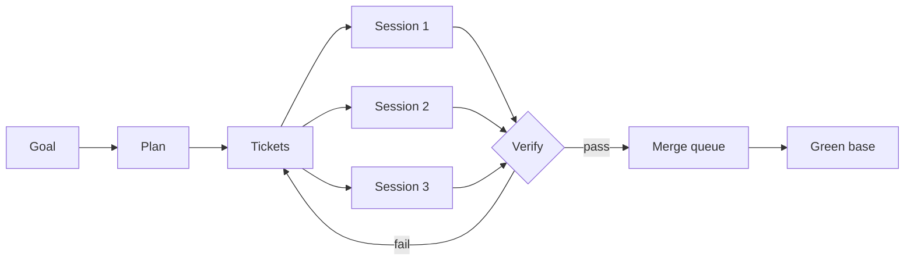

# KaaS Factory

KaaS Factory turns a goal into reviewed pull requests: it plans tickets, runs them on parallel
coding-agent sessions, checks each result against your gates, and lands them through a merge queue.

## Quickstart

Inside the repository you want to automate:

```sh
factory doctor
factory init --tier solo
factory first-run --dry-run
```

`doctor` checks your tools. `init` writes `factory.yaml` into your repo's `.factory` folder. `first-run --dry-run` audits the
repository, lists the first fixes, and changes nothing.

## The loop



Each ticket runs in its own session. Your own gates (tests, lint, build) decide whether a result moves
on. The merge queue lands one change at a time, so the base stays green. Risky changes wait for your
approval.

## Install

```sh
brew install kaas-team/tap/factory
```

Or, with no sudo (installs to `$HOME/.local/bin`, checks the checksum first):

```sh
curl -fsSL https://raw.githubusercontent.com/KaaS-team/factory/main/install.sh | sh
```

Or build from source with Go 1.26 or newer: `go install github.com/KaaS-team/factory/cmd/factory@latest`. More in [docs/install.md](docs/install.md).

## CLI

```sh
factory plan "add rate limiting to the API"
factory plan "add rate limiting to the API" --approve
factory run
factory status
factory queue
factory logs <ticket>
factory steer <ticket> "use the existing limiter"
factory cancel <ticket>
factory retry <ticket>
```

`plan` turns a goal into a ticket graph. `--approve` files it. `run` starts the loop.

### Command list

| Group | Commands |
|---|---|
| Set up | `doctor`, `init`, `first-run`, `config`, `packs`, `add`, `upgrade`, `version` |
| Plan and run | `plan`, `run`, `dispatch`, `serve`, `eval`, `design`, `review`, `repomap`, `checkpoint`, `browsercheck` |
| Watch and steer | `status`, `queue`, `logs`, `steer`, `cancel`, `retry`, `board`, `dashboard`, `report`, `shadow`, `audit` |
| Connect | `mcp`, `a2a` |

The full flag list for every command is in [docs/cli-reference.md](docs/cli-reference.md). A test keeps
it equal to the real command tree.

## MCP

Use the factory from Claude Code or any MCP client.

```sh
factory mcp
```

This serves over stdio. Add `--http 127.0.0.1:8080` for HTTP at `/mcp`; it needs a bearer secret
(see `factory mcp --help`). Tools include `plan`, `approve_plan`, `create_task`, `status`, `list_tickets`,
`queue`, `dispatch`, `cancel`, `retry` and `steer`. The board is a resource at `factory://board`.

## Tiers

Pick one with `factory init --tier <name>`. Each tier is a preset you can edit afterwards.

| Tier | `--tier` | What it sets |
|---|---|---|
| Solo | `solo` | One slot, local sessions, you approve every change. |
| Team | `startup`, `scaleup` | Three to six slots on routines, low-risk changes auto-approve. |
| Org | `enterprise` | Six slots, approval always, daily team and monthly spend caps. |
| Enterprise | `regulated` | Approval always, and the requester cannot approve or auto-merge. |

`oss` is a fifth preset: two local slots, approval always.

## Configuration

Settings come from layers, lowest to highest: defaults, the org file, the team file, the repository
file, `FACTORY_*` variables, and flags. The org layer is a ceiling. Every key is in
[docs/config.md](docs/config.md).

## Links

- [docs/config.md](docs/config.md) for every setting.
- [AGENTS.md](AGENTS.md) for the package map and the gate.
- Issues and releases: https://github.com/KaaS-team/factory

## Contributing and license

See [CONTRIBUTING.md](CONTRIBUTING.md) and [LICENSE](LICENSE).
