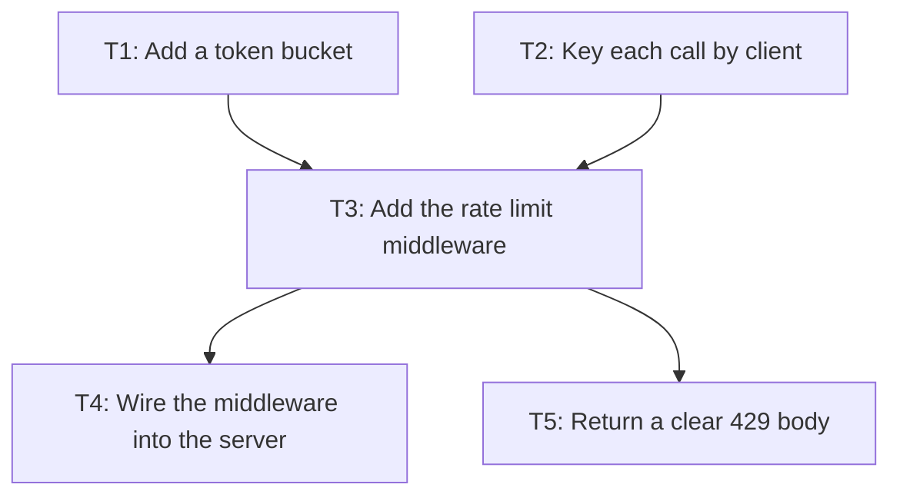

# Demo: `factory plan`

A goal becomes a ticket graph a client can read and approve. Nothing is filed until `--approve`.

## Run it

```
factory plan "Add rate limiting to the public API" --repo-dir tests/fixtures/splitbill
```

With a goal, the planner reads the repo with your own agent login and drafts the spec and tickets.
That step needs a logged-in agent, so the run below feeds it a saved draft with `--spec`. The checks,
the waves and the graph are the same code in both cases.

```
factory plan --spec internal/plan/testdata/splitbill/rate-limit.spec.md --repo-dir tests/fixtures/splitbill
```

Output:

## Wave 1

### T1: Add a token bucket

**Problem:** Nothing limits how often one client can call the API, so one noisy client can slow everyone.

**Acceptance:**
- AC-1: a bucket allows N calls per window and then refuses

Files: `src/ratelimit.ts`, `tests/ratelimit.test.ts`
Depends on: none

### T2: Key each call by client

**Problem:** The limiter needs a stable key per caller. Today a call has no key.

**Acceptance:**
- AC-2: a call with a token is keyed by the token, else by IP

Files: `src/clientkey.ts`, `tests/clientkey.test.ts`
Depends on: none

## Wave 2

### T3: Add the rate limit middleware

**Problem:** The bucket and the key exist but no request passes through them.

**Acceptance:**
- AC-3: the middleware refuses over-limit calls with status 429

Files: `src/middleware/ratelimit.ts`, `tests/middleware-ratelimit.test.ts`
Depends on: T1, T2

## Wave 3

### T4: Wire the middleware into the server

**Problem:** The server does not use the middleware, so the public routes stay open.

**Acceptance:**
- AC-4: every public route is behind the limit

Files: `src/server.ts`, `tests/server.test.ts`
Depends on: T3

## Wave 4

### T5: Return a clear 429 body

**Problem:** A refused client gets no hint about when to retry.

**Acceptance:**
- AC-5: a 429 carries a Retry-After header and a short JSON error

Files: `src/routes/errors.ts`, `src/server.ts`
Depends on: T3



T5 waits for wave 4, not wave 3, because it shares `src/server.ts` with T4. No two tickets in one wave share a file.

## Approve

```
factory plan "Add rate limiting to the public API" --repo-dir <repo> --approve
```

This files one issue per ticket, dependencies first, each with the `factory:planned` marker and a
`Blocked by: #n` line. A title that is already filed is skipped, so a second run files nothing.

## A bad plan is refused

A plan with a cycle, a repeated ticket, or an unknown dependency prints `Problems:` and `--approve` files nothing.

```
Problems:
  - the blocking edges have a cycle: T1 -> T5 -> T3 -> T1
```
